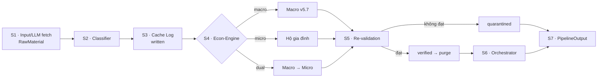
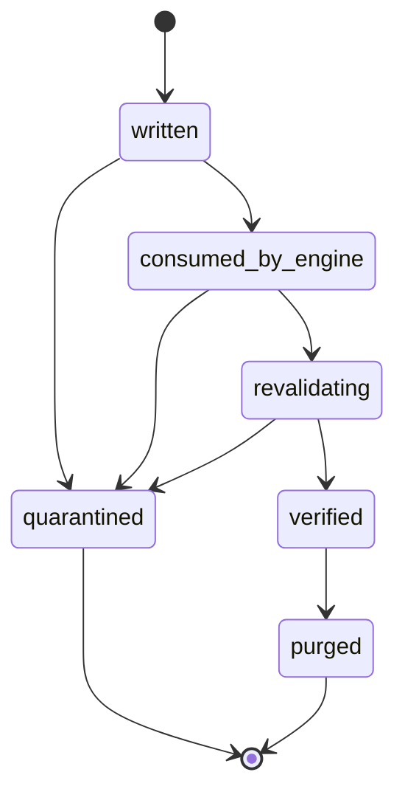

<div align="center">

# OSINTViet

**Kinh tế vĩ mô → vi mô, dành cho người Việt.**

Một website OSINT thiên về kinh tế, hướng tới cộng đồng và dành cho người nói
tiếng Việt. Mục tiêu là đưa các khái niệm kinh tế vĩ mô vào đời sống thường
ngày, vì lợi ích chung.

**Website:** [In future waitlist...]

[](https://www.python.org/)
[](https://fastapi.tiangolo.com/)
[](https://sqlmodel.tiangolo.com/)
[](LICENSE)

[👋 Dành cho người dùng](#nguoi-dung) ·
[🇬🇧 English](#english) ·
[🚀 Bắt đầu nhanh](#bat-dau-nhanh) ·
[🧭 Chọn chế độ](#chon-che-do) ·
[🏗️ Kiến trúc](#kien-truc) ·
[🛠️ Công nghệ](#cong-nghe) ·
[⌨️ Dòng lệnh](#dong-lenh) ·
[🔐 BYOK](#byok) ·
[📚 Tài liệu](#tai-lieu) ·
[⚖️ Miễn trừ](#mien-tru)

</div>

---

> [!NOTE]
> Toàn bộ nội dung dành cho người dùng cuối là tiếng Việt, trừ phần
> [English overview](#english). Mã nguồn, comment và báo cáo kỹ thuật giữ tiếng
> Anh. Hướng dẫn vận hành nằm tại
> [`docs/HUONG_DAN_PIPELINE_V2.md`](docs/HUONG_DAN_PIPELINE_V2.md); tài liệu kỹ
> thuật đầy đủ bằng tiếng Anh nằm tại
> [`docs/TECHNICAL_REFERENCE.md`](docs/TECHNICAL_REFERENCE.md).

> [!WARNING]
> **Không phải lời khuyên đầu tư hoặc tư vấn tài chính.** Kết quả chỉ mang tính
> tham khảo và giáo dục. Đọc [Tuyên bố miễn trừ trách nhiệm](#mien-tru) trước
> khi dùng bất kỳ con số nào cho quyết định thật.

> [!CAUTION]
> **Thử nghiệm beta kín — Closed beta.**
> Sản phẩm này vẫn đang trong giai đoạn thử nghiệm beta kín. Giao diện website sẽ
> ra mắt trong thời gian tới, nhưng ngày cụ thể vẫn chưa được công bố. Mọi bất
> thường gặp phải có thể được báo cáo qua [mục liên hệ](#contact). Người dùng nên
> kỳ vọng sẽ gặp các bất thường và hiểu rõ rủi ro khi sử dụng một dự án chưa
> hoàn thiện.
> 
> This product is still in closed beta testing. The website interface is coming,
> but the specific date remains undisclosed. Any anomaly encountered can be
> reported via the [contact](#contact) section. Users should expect anomalies and
> understand the risks of working on an unfinished project.

> [!NOTE]
> **Đội ngũ phát triển — Development team.**
>
> Sản phẩm này được phát triển bởi một nhóm chỉ gồm 4 người, dựa trên kiến trúc
> và lý thuyết mã nguồn mở. 
>
> This product is backed by a team of only four people, using open-source
> architecture and theory. 

<a id="muc-luc" name="muc-luc"></a>

<details open>
<summary><strong>📑 Mục lục</strong> — bấm để mở/đóng</summary>

- [Dành cho người dùng thường](#nguoi-dung)
- [Tuyên bố miễn trừ trách nhiệm](#mien-tru)
- [English overview](#english)
- [For researchers and developers](#researchers)
- [Ứng dụng AI - Use of Artificial Intelligence](#ai-use)
- [Tổng quan kỹ thuật](#tong-quan)
- [Chọn chế độ phù hợp](#chon-che-do)
- [Bắt đầu nhanh](#bat-dau-nhanh)
- [Kiến trúc Pipeline V2](#kien-truc)
- [Công nghệ và công cụ](#cong-nghe)
- [Bối cảnh cá nhân và hồ sơ hộ](#boi-canh)
- [BYOK và quyền riêng tư](#byok)
- [Dòng lệnh](#dong-lenh)
- [Vòng đời cache và purge](#cache)
- [Kiểm tra lại (S5)](#kiem-tra-lai)
- [Cấu hình](#cau-hinh)
- [Engine hộ gia đình (micro)](#micro)
- [Kiểm thử và stress](#kiem-thu)
- [Giới hạn bạn cần biết](#gioi-han)
- [Câu hỏi thường gặp](#faq)
- [Liên hệ](#contact)
- [Tài liệu](#tai-lieu)
- [Giấy phép](#giay-phep)

</details>

<a id="nguoi-dung" name="nguoi-dung"></a>

## Dành cho người dùng thường

> [!TIP]
> Bạn không cần biết S1–S7, tên engine hay cấu hình. Chỉ cần hiểu hệ thống nhận
> câu hỏi, tính toán dựa trên dữ liệu và công thức, rồi kiểm tra lại trước khi
> trả lời.

### Hệ thống giúp bạn làm gì?

**OSINT** (Open Source Intelligence) là thu thập và phân tích thông tin từ nguồn
công khai. OSINTViet áp dụng cách làm đó cho kinh tế, và trả lời hai câu hỏi:

1. **Bức tranh lớn đang thế nào?** — lạm phát, lãi suất, tăng trưởng, giá cả,
   thất nghiệp... (phần **vĩ mô**).
2. **Điều đó ảnh hưởng đến một hộ gia đình ra sao?** — thu nhập, chi tiêu,
   tiết kiệm, nợ và khả năng chịu đựng cú sốc (phần **vi mô**).

Bạn có thể hỏi riêng từng phần, hoặc nối lại để thấy chuỗi tác động từ kinh tế
chung đến gia đình mình.

### Một lần chạy diễn ra thế nào?

1. **Bạn đặt câu hỏi** và, nếu muốn, cung cấp hồ sơ hộ gia đình (thu nhập, chi
   tiêu, tài sản, nợ).
2. **Hệ thống tìm dữ liệu** từ nguồn công khai hoặc dữ liệu đã lưu, rồi tính
   toán bằng các công thức kinh tế.
3. **Hệ thống kiểm tra lại** xem kết quả có nguồn, có nhất quán và đúng chế độ
   không.
4. **Bạn nhận câu trả lời** kèm nguồn, giả định và cảnh báo. Chỗ nào thiếu dữ
   liệu sẽ ghi `not_estimated`, không tự bịa số.

### Bạn nên bắt đầu từ đâu?

Mỗi lần chạy, bạn chọn một **chế độ** — hiểu đơn giản là hệ thống sẽ trả lời
phần nào và theo thứ tự nào.

| Nếu bạn... | Chọn |
| --- | --- |
| Chỉ muốn hiểu bức tranh kinh tế chung | `macro` |
| Có số liệu thu nhập/chi tiêu và muốn xem tác động lên gia đình | `micro` |
| Muốn nối bức tranh chung với gia đình mình | `dual` |
| Không chắc nên chọn gì | `auto` |

> [!TIP]
> Câu hỏi càng cụ thể càng dễ trả lời. Thay vì “kinh tế thế nào?”, hãy hỏi
> “lạm phát tăng ảnh hưởng chi tiêu thực phẩm của gia đình tôi ra sao?”.

### Ba điều nên nhớ

- **Đây là công cụ tham khảo, không phải lời khuyên đầu tư.**
- **Kết quả phụ thuộc vào dữ liệu bạn nhập.** Thiếu dữ liệu thì câu trả lời sẽ
  ít chi tiết hơn.
- **Hãy đọc cảnh báo và nguồn** trước khi dùng một con số cho quyết định thật.

> [!CAUTION]
> Không nhập số CCCD/CMND, số tài khoản ngân hàng, mật khẩu, khóa bí mật hay
> API key vào tệp bối cảnh/hồ sơ hộ. Hệ thống không cần những thông tin này.

<a id="mien-tru" name="mien-tru"></a>

## Tuyên bố miễn trừ trách nhiệm

> [!WARNING]
> OSINTViet chỉ cung cấp thông tin tham khảo và giáo dục. Nội dung không phải
> lời khuyên đầu tư, tư vấn tài chính, pháp lý, thuế hoặc kế toán.

Cụ thể:

- **Không phải khuyến nghị mua/bán** chứng khoán, bất động sản, vàng, ngoại tệ
  hay bất kỳ tài sản nào.
- **Không phải lời khuyên vay, trả nợ, bảo hiểm, lương hưu hoặc đầu tư cá nhân.**
- **Không phải tư vấn pháp lý, thuế hay kế toán.** Hãy hỏi chuyên gia có chuyên
  môn và giấy phép phù hợp.
- **Không phải dự báo chắc chắn.** Kết quả là ước lượng có điều kiện, phụ thuộc
  dữ liệu, giả định và cấu hình tại thời điểm chạy.

Số liệu có thể sai, thiếu, lỗi thời hoặc không phù hợp với hoàn cảnh của bạn.
Các yếu tố như chính sách, thị trường và dữ liệu công khai có thể thay đổi sau
khi kết quả được tạo. Bạn tự chịu trách nhiệm kiểm chứng thông tin và quyết
định cuối cùng. Trong phạm vi pháp luật cho phép, nhà phát triển không đưa ra
cam kết về tính chính xác, đầy đủ hoặc kịp thời, và không chịu trách nhiệm cho
thiệt hại phát sinh từ việc dùng kết quả trái với mục đích tham khảo.

<a id="english" name="english"></a>

## English overview

OSINTViet is an open-source economic analysis pipeline built for Vietnamese
readers. It starts with a question about the economy. If you also provide a
household's numbers — income, spending, assets, debt and size — it connects the
national picture to that household. A run can stop at the macro level, work only
on the household, or carry the macro result into the household model.

The system is built around one rule: a number must be calculated from your
inputs, taken from a cited public source, or left as `not_estimated`. It does
not fill a missing value with a plausible guess.

### What happens in a run

1. **Input.** The pipeline reads your question and, optionally, a household
   file with income, spending, assets, debt and household size.
2. **Classification.** A deterministic lexicon and embedding prototypes label
   the request as `macro`, `micro` or `mixed`. You can choose the mode yourself;
   your choice always wins.
3. **Cache.** A run-scoped cache log stores the processed material. Personal
   context stays in memory unless you set `persist_opt_in=true`.
4. **Engines.** The macro engine (SPEC-MACRO-QUANT v5.7) builds a 36-series
   Vietnam panel, estimates factors and regimes, searches for a plausible
   adverse shock, and simulates three policy branches. The household engine
   uses QUAIDS demand, BPP income shocks, a buffer-stock model and FGT/VEP
   poverty measures. In `dual` mode it reads the macro artifact through
   a read-only bridge.
5. **Re-validation.** Grounding, consistency, completeness and mode integrity
   must all pass. A failed check quarantines the run's cache entries and fails
   the run; the pipeline does not repair it with invented data.
6. **Output.** The result is JSON with sources, formulas, assumptions, warnings
   and the validation report. Logs go to stderr; JSON goes to stdout.

### Modes

| Mode | Use it when | What runs |
| --- | --- | --- |
| `macro` | You want the national picture only | Macro engine; no household result |
| `micro` | You have household numbers and want their exposure | Household engine; no macro result |
| `dual` | You want the chain from the economy to the household | Macro first, then household with the macro artifact |
| `auto` | You are not sure | The classifier recommends a mode; `--allow-dual` resolves a mixed signal |

### What the system will not do

- It will not turn a missing input into a number. A channel with no data is
  reported as `not_estimated`, which means "not enough information", not zero.
- It will not present a model output as a forecast or as investment, legal, tax
  or financial advice.
- It will not store your personal context by default. Cloud LLM and Cohere calls
  can receive processed text when those services are enabled; local Ollama does
  not.
- It will not invent a missing macro series. Missing cells are imputed and
  recorded; a series with no observations, or a panel that cannot supply the
  core contract, stops the run with a structured error.

### Documentation

- [Technical reference](docs/TECHNICAL_REFERENCE.md) - the full English
  description of the architecture, mathematics, economic models, configuration,
  appendix and glossary.
- [Vietnamese operating guide](docs/HUONG_DAN_PIPELINE_V2.md)
- [Pipeline V2 completion report](docs/PIPELINE_V2_COMPLETION_REPORT.md)

<a id="researchers" name="researchers"></a>

## For researchers and developers

OSINTViet is a local-first, deterministic pipeline with a clear boundary between
calculation and language generation. The architecture is meant to be read,
audited and extended, not treated as a black box.

### Architectural fundamentals

- **Seven-stage pipeline (S1–S7).** Raw input → classifier → run-scoped cache →
  economic engine(s) → re-validation and purge → orchestration → JSON output.
  Each stage has a typed contract in `app/pipeline_v2/contracts.py`, and a run
  fails closed rather than skipping a stage.
- **Calculation is separate from prose.** Macro and household results come from
  the engines in `app/math_engine/`; the LLM is used for language work and
  orchestration, not to produce or repair numbers. Missing data becomes
  `not_estimated`, never a plausible guess.
- **Configuration over hard-coding.** Coefficients, thresholds and calibration
  values live in `config/*.json` and the engine calibration modules; they are
  documented in the technical reference rather than scattered through the code.
- **Macro engine (SPEC-MACRO-QUANT v5.7).** A 36-series Vietnam panel feeds
  calibration, a Rao-Blackwellized particle filter, regime detection, an
  adversarial shock search, Sobol simulation, Wasserstein medoid selection and
  firm-level Arrow downscaling; a gatekeeper decides whether the run passes.
- **Household engine.** QUAIDS demand, BPP income shocks, a buffer-stock model
  and FGT/VEP poverty measures, runnable alone or fed by the macro artifact
  through a read-only Arrow bridge.
- **Re-validation is part of the method.** Grounding, consistency, completeness
  and mode integrity are checked before output; a failed check quarantines the
  run's cache entries and returns a structured error.
- **Privacy boundaries are explicit.** Personal context stays in memory unless
  `persist_opt_in=true`; BYOK keys are read at runtime and never written to
  cache, logs or the database.

### Documentation map

| Document | What it covers |
| --- | --- |
| [`docs/TECHNICAL_REFERENCE.md`](docs/TECHNICAL_REFERENCE.md) | Full English reference: architecture, formulas, model coefficients, thresholds, configuration, appendices and glossary |
| [`docs/PIPELINE_V2_COMPLETION_REPORT.md`](docs/PIPELINE_V2_COMPLETION_REPORT.md) | Implementation record, verification results and stress-test outcomes |
| [`docs/discovery_report.md`](docs/discovery_report.md) | Phase 0 read-only audit: baseline commands, module map and dependency review |
| [`docs/HUONG_DAN_PIPELINE_V2.md`](docs/HUONG_DAN_PIPELINE_V2.md) | Vietnamese operating guide for running and configuring Pipeline V2 |

If you are extending the engine, start with the technical reference, then read
the stage contracts and the corresponding tests under `tests/`. The deterministic
suite runs without a live LLM:

```bash
.venv/bin/python tests/test_pipeline_v2.py
```

<a id="ai-use" name="ai-use"></a>

## Ứng dụng Trí tuệ Nhân tạo (Use of Artificial Intelligence)

OSINTViet dùng AI cho phần ngôn ngữ và so khớp ngữ nghĩa — đọc và tóm tắt, gợi
ý chủ đề, phân loại hỗ trợ, sinh giả thuyết và phản biện — nhưng không dùng AI
để tạo các kết quả kinh tế, bịa số liệu hay tự chứng nhận kết quả. Phần tính
toán, kiểm định và truy xuất nguồn nằm trong mã nguồn và dữ liệu.

AI is used for language and semantic-similarity work — reading and summarising,
suggesting topics, advisory classification, and hypothesis generation/critique —
but not for producing economic results, inventing numbers, or certifying its own
output. Calculation, validation and provenance stay in code and data. A public
chatbot is not a substitute: it does not run the economic engines, check
evidence, or keep a reproducible batch record.

Chi tiết song ngữ Việt/Anh: [`docs/USE_OF_AI.md`](docs/USE_OF_AI.md).

<a id="tong-quan" name="tong-quan"></a>

## Tổng quan kỹ thuật

**OSINTViet** gom quy trình phân tích kinh tế vào một pipeline thống nhất:
nhận truy vấn và bối cảnh cá nhân → phân loại vĩ mô/vi mô → lưu cache theo
`run_id` → chạy engine kinh tế → kiểm tra lại → purge cache đã kiểm chứng →
orchestrator → JSON.

Pipeline V2 được thiết kế để:

- **Tính toán thay vì suy diễn**: mọi con số hoặc được tính từ đầu vào của bạn,
  hoặc được trích dẫn nguồn. Thiếu dữ liệu thì ghi `not_estimated`.
- **Tách cấu hình khỏi mã**: hệ số kinh tế và ngưỡng vận hành nằm trong
  `config/*.json`, không hard-code.
- **Bảo vệ dữ liệu cá nhân**: bối cảnh chỉ được lưu khi bạn chủ động opt-in.
- **Fail-closed**: kiểm tra lại không đạt thì entry của run bị cách ly, không
  purge và không fallback sang số giả.

Pipeline V2 dùng lại engine vĩ mô **SPEC-MACRO-QUANT v5.7** và bổ sung engine hộ
gia đình chạy độc lập hoặc nhận artifact v5.7 qua bridge chỉ đọc.

<a id="chon-che-do" name="chon-che-do"></a>

## Chọn chế độ phù hợp

| Mode | Khi nào dùng | Hành vi |
| --- | --- | --- |
| `macro` | Chỉ cần bức tranh kinh tế vĩ mô | Chạy engine v5.7; không trả `MicroResult` |
| `micro` | Muốn biết tác động lên hộ gia đình | Chạy engine hộ gia đình; không cần macro |
| `dual` | Muốn cả vĩ mô và vi mô | Chạy macro trước, truyền artifact v5.7 qua bridge chỉ đọc sang micro |
| `auto` | Chưa chắc nên chọn gì | Dùng classifier gợi ý; mode do bạn chọn luôn thắng |

> [!TIP]
> **Mode do người dùng chọn luôn thắng.** Classifier chỉ gợi ý. Nếu classifier
> trả `mixed` hoặc độ tin cậy dưới ngưỡng, pipeline báo lỗi có cấu trúc — thêm
> `--allow-dual` nếu muốn tự chuyển sang `dual`.

<details>
<summary><strong>🧭 “Tôi chỉ muốn hiểu bức tranh vĩ mô” → <code>macro</code></strong></summary>

```bash
.venv/bin/python run_full_workflow.py --mode macro \
  --query "Lạm phát CPI Việt Nam chịu tác động từ đâu?"
```

Kết quả gồm các claim vĩ mô có nguồn, không có phần hộ gia đình.

</details>

<details>
<summary><strong>🏠 “Tôi muốn biết giá thực phẩm ảnh hưởng chi tiêu của tôi thế nào?” → <code>micro</code></strong></summary>

Chuẩn bị `context.json` và `household.json` (xem [mục bối cảnh](#boi-canh)), sau đó:

```bash
.venv/bin/python run_full_workflow.py --mode micro \
  --query "Giá thực phẩm tăng ảnh hưởng chi tiêu ra sao?" \
  --context-file context.json --household-file household.json
```

Kênh nào thiếu dữ liệu sẽ được ghi `not_estimated`, không tự bịa số.

</details>

<details>
<summary><strong>🔗 “Tôi muốn nối vĩ mô với hộ gia đình” → <code>dual</code></strong></summary>

```bash
.venv/bin/python run_full_workflow.py --mode dual \
  --query "Lạm phát và lãi suất ảnh hưởng hộ gia đình tôi thế nào?" \
  --context-file context.json --household-file household.json
```

Macro chạy xong mới chạy micro. Nếu macro lỗi, micro không chạy.

</details>

<details>
<summary><strong>🤖 “Tôi không chắc nên chọn gì” → <code>auto</code></strong></summary>

```bash
.venv/bin/python run_full_workflow.py --mode auto \
  --query "Lạm phát ảnh hưởng đến chi tiêu hộ gia đình ra sao?" \
  --context-file context.json --household-file household.json
```

Nếu tín hiệu là `mixed` hoặc không đủ tin cậy, thêm `--allow-dual` để cho phép
chuyển sang `dual`.

</details>

<a id="bat-dau-nhanh" name="bat-dau-nhanh"></a>

## Bắt đầu nhanh

> [!TIP]
> Mới dùng lần đầu? Đọc [Dành cho người dùng thường](#nguoi-dung) trước để hiểu
> hệ thống làm gì và nên chọn chế độ nào.

> [!IMPORTANT]
> Yêu cầu **Python 3.11+**. Các lệnh dưới đây chạy từ thư mục gốc của dự án.

**1. Tạo môi trường và cài dependency**

```bash
python3 -m venv .venv
source .venv/bin/activate
pip install -r requirements.txt
```

**2. Tạo cấu hình môi trường**

```bash
cp .env.example .env
# Mở .env và điền giá trị phù hợp.
# Tuyệt đối không commit .env hoặc keys_pool.json.
```

**3. Khởi tạo cơ sở dữ liệu**

```bash
.venv/bin/python init_db.py
```

**4. Chạy thử an toàn (không ghi DB/artifact, không purge, không chạy S6)**

```bash
.venv/bin/python run_full_workflow.py --mode micro \
  --query "Giá thực phẩm tăng ảnh hưởng chi tiêu ra sao?" \
  --dry-run --skip-orchestrator
```

**5. Mở giao diện web (tùy chọn)**

```bash
.venv/bin/uvicorn app.main:app --reload --port 8000
```

Mở `http://127.0.0.1:8000/pipeline-v2` để xem hướng dẫn trên website. API tương
ứng:

```bash
curl -X POST http://127.0.0.1:8000/api/v1/pipeline-v2/run \
  -H "Content-Type: application/json" \
  -d '{"query":"Lạm phát ảnh hưởng hộ gia đình tôi thế nào?","mode":"auto","dry_run":true}'
```

> [!TIP]
> Nếu chưa cấu hình LLM, pipeline dùng router hiện có (Ollama cục bộ hoặc key
> pool đã cấu hình). Chỉ cần `--live` khi muốn fetch bài báo trực tiếp; mặc định
> pipeline dùng truy vấn và panel World Bank đã cache.

<a id="kien-truc" name="kien-truc"></a>

## Kiến trúc Pipeline V2

Mỗi lần chạy đi qua đúng bảy tầng:



| Tầng | Việc diễn ra | Ghi chú |
| --- | --- | --- |
| **S1** | Nhận `RawInput`, tạo `RawMaterial`, phân rã truy vấn | Mặc định chỉ dùng truy vấn + panel World Bank đã cache; bài báo live là tùy chọn `--live` |
| **S2** | Phân loại bằng lexicon tất định + embedding prototype | Ngưỡng lấy từ `config/classifier_calibration.json` |
| **S3** | Ghi nội dung đã xử lý và vector vào `cache_log_entries` | Bối cảnh cá nhân chỉ được lưu khi `persist_opt_in=true` |
| **S4** | Chạy engine macro, micro hoặc dual | Macro adapter mỏng quanh engine v5.7; micro chạy độc lập được |
| **S5** | Grounding, consistency, completeness, mode integrity | Chỉ purge khi **tất cả** kiểm tra đạt |
| **S6** | `UniversalCoScientistPipeline` hiện có | Tái sử dụng embedding/router/plugin; ingestor thô tạm tắt |
| **S7** | Xuất `PipelineOutput` JSON | Không chứa nội dung cache thô, không chứa bối cảnh cá nhân |

<a id="cong-nghe" name="cong-nghe"></a>

## Công nghệ và công cụ

Các thành phần dưới đây được dùng tùy cấu hình; không phải tất cả đều bắt buộc
trong mọi lần chạy.

### Nền tảng và thư viện

| Thành phần | Vai trò trong hệ thống |
| --- | --- |
| **Python 3.11+** | Ngôn ngữ chạy toàn bộ pipeline |
| **FastAPI + Uvicorn** | API HTTP và máy chủ web |
| **Pydantic** | Kiểm tra và chuẩn hóa dữ liệu vào/ra |
| **SQLModel + SQLAlchemy + SQLite** | Lưu cache log, audit và dữ liệu vận hành |
| **ChromaDB** | Lưu vector embedding cục bộ |
| **Playwright + Chromium** | Fetch bài báo live khi dùng `--live` |
| **Jinja2** | Giao diện dự phòng khi chưa build frontend |
| **React + Vite + Tailwind CSS** | Giao diện web hiện đại |
| **MCP server (tùy chọn)** | Mở orchestrator qua giao thức MCP |

### Dịch vụ bên ngoài (tùy cấu hình)

| Dịch vụ/công cụ | Khi nào dùng | Dữ liệu có thể đi ra ngoài |
| --- | --- | --- |
| **World Bank API** | Lấy panel 36 cột từ 35 chỉ số kinh tế | Mã quốc gia/chỉ số; không cần hồ sơ hộ |
| **Cohere Embed v5 Pro** | Khi bật embedding Cohere | Văn bản cần tạo embedding |
| **LLM đám mây (BYOK hoặc key pool)** | Khi cấu hình nhà cung cấp cloud | Truy vấn và bối cảnh có thể nằm trong prompt |
| **Ollama cục bộ** | Mặc định khi không dùng cloud | Không gửi ra ngoài nếu chạy trên máy |
| **Playwright + Chromium** | Chỉ khi thêm `--live` | Tải nội dung bài báo công khai |

> [!NOTE]
> Nếu bạn muốn giảm dữ liệu gửi ra ngoài, hãy dùng Ollama cục bộ và không bật
> Cohere. Với dịch vụ đám mây, chính sách lưu trữ và xử lý dữ liệu do nhà cung
> cấp quy định; hãy đọc chính sách của họ trước khi dùng. API key BYOK không bao
> giờ được đưa vào cache, log hay database.

### Phương pháp và engine nội bộ

| Thành phần | Vai trò |
| --- | --- |
| **SPEC-MACRO-QUANT v5.7** | Engine phân tích vĩ mô |
| **UniversalCoScientistPipeline** | Orchestrator S6, tái sử dụng plugin/router hiện có |
| **ProbLog** | Kiểm tra logic và tri thức dạng rule |
| **Sandbox + HMAC attestation** | Chạy và chứng thực kết quả trong sandbox |
| **Negative memory** | Lưu các bài học/bẫy đã biên dịch để tránh lặp lại |
| **QUAIDS, Stone-Geary LES** | Ước lượng nhu cầu và phúc lợi hộ gia đình |
| **BPP GMM, EGM, HANK, Merton, FGT, VEP, Carroll-Toche** | Các mô hình tiết kiệm, bảo hiểm, bất định và nghèo đói |
| **Tornqvist/Fisher/Laspeyres/Paasche, Hicks CV, equivalence scale** | Chỉ số giá, thay đổi phúc lợi và quy đổi quy mô hộ |
| **Arrow zero-copy** | Tính toán trên population mà không sao chép dữ liệu lớn |

<a id="boi-canh" name="boi-canh"></a>

## Bối cảnh cá nhân và hồ sơ hộ

`PersonalContext` (tệp `--context-file`) chỉ nhận các trường văn bản:

```json
{
  "free_text": "Thu nhập 20 triệu, chi tiêu 15 triệu, tiết kiệm 60 triệu",
  "region": "Hà Nội",
  "occupation_sector": "giáo dục",
  "household_notes": "2 người lớn, 1 trẻ em",
  "assets_liabilities_notes": "Có khoản vay mua nhà",
  "persist_opt_in": false
}
```

Số liệu hộ tường minh nên đặt trong `HouseholdProfile` (`--household-file`):

```json
{
  "monthly_income_million_vnd": 22.0,
  "monthly_expenditure_million_vnd": 18.0,
  "budget_shares_w0": [0.45, 0.25, 0.12, 0.18],
  "n_adults": 2,
  "n_children": 1,
  "liquid_assets_million_vnd": 18.0,
  "illiquid_assets_million_vnd": 450.0,
  "monthly_debt_service_million_vnd": 3.2,
  "crra_rho": 2.5
}
```

<details>
<summary><strong>📋 Quy tắc bắt buộc khi nhập dữ liệu</strong></summary>

- Không nhập API key vào hai tệp trên.
- `budget_shares_w0` phải có đúng **4 phần** và tổng bằng **1**.
- Thiếu trường nào thì khối/kênh tương ứng là `not_estimated`; hệ thống không
  tự bịa số.
- `persist_opt_in=false` (mặc định): bối cảnh chỉ nằm trong bộ nhớ của lần chạy.
  Artifact `raw_material.json` không chứa `personal_dimensions` /
  `explicit_parameters`; trace `llm_calls.json` không chứa prompt/response.
- `persist_opt_in=true`: bối cảnh được lưu cùng cache log và bị purge sau khi
  kiểm chứng.
- `--household-file` là đầu vào số học tường minh do bạn cung cấp, tách khỏi
  `PersonalContext`. Kết quả micro có thể nhắc lại các con số này để giải thích
  công thức.

</details>

<a id="byok" name="byok"></a>

## BYOK và quyền riêng tư

Bạn có thể dùng API key của riêng mình (**Bring Your Own Key - BYOK**). Key chỉ đọc từ
`OSINT_BYOK_API_KEY` hoặc `--byok-stdin`, và **chỉ nằm trong bộ nhớ tiến
trình**.

```bash
export OSINT_BYOK_API_KEY="..."                         # không commit vào git
export OSINT_BYOK_BASE_URL="http://127.0.0.1:3001/v1"   # FreeLLMAPI cục bộ
export OSINT_BYOK_MODEL="gemini-3.8-flash"              # tùy chọn

# Hoặc đọc đúng một dòng từ stdin, không echo:
printf '%s\n' "$OSINT_BYOK_API_KEY" | \
  .venv/bin/python run_full_workflow.py --mode macro \
  --query "Lạm phát CPI" --byok-stdin
```

Khi chạy server, có thể đặt các biến này trong `.env` (đã nằm trong
`.gitignore`) hoặc trong môi trường của service. Không commit `.env` lên git.

> [!CAUTION]
> Key **không bao giờ** đi vào cache, audit, log, lỗi hay database. Nếu không có
> key, pipeline dùng router hiện có (Ollama cục bộ hoặc key pool đã cấu hình).

<details>
<summary><strong>🔐 Bối cảnh cá nhân được lưu và xóa như thế nào?</strong></summary>

| Dữ liệu | Mặc định (`persist_opt_in=false`) | Khi opt-in (`true`) |
| --- | --- | --- |
| Bối cảnh cá nhân | Chỉ tồn tại trong bộ nhớ của lần chạy | Được lưu cùng cache log |
| `raw_material.json` | Chỉ còn marker `personal_parameters_redacted: true` | Có thể chứa `explicit_parameters` và `personal_dimensions` |
| `llm_calls.json` | Không chứa prompt/response; S1 chỉ còn metadata | Theo cơ chế trace của run |
| Purge | Sau khi kiểm chứng | Sau khi kiểm chứng |

Audit `cache_purge_audits` chỉ chứa `run_id`, số lượng, thời điểm và kết quả;
không chứa nội dung. Bản ghi `quarantined` **không bao giờ** bị purge tự động.

</details>

<a id="dong-lenh" name="dong-lenh"></a>

## Dòng lệnh

`run_full_workflow.py` và `main.py` đều có thể chạy Pipeline V2. Có thể dùng
tường minh subcommand `run`, hoặc bỏ qua như các ví dụ trong tài liệu.

```bash
# Chạy dual, JSON ra stdout
.venv/bin/python run_full_workflow.py --mode dual \
  --query "Lạm phát và lãi suất ảnh hưởng hộ gia đình tôi thế nào?" \
  --context-file context.json --household-file household.json

# Chạy thử: không ghi DB/artifact, không purge thật, không chạy S6
.venv/bin/python run_full_workflow.py --mode micro \
  --query "Giá thực phẩm tăng ảnh hưởng chi tiêu ra sao?" \
  --context-file context.json --dry-run --skip-orchestrator

# Xuất văn bản dễ đọc
.venv/bin/python run_full_workflow.py --mode macro \
  --query "Lạm phát CPI" --output human

# Kiểm tra / xóa bản ghi cách ly (không bao giờ tự động)
.venv/bin/python run_full_workflow.py quarantine-list
.venv/bin/python run_full_workflow.py quarantine-delete --run-id run_... --dry-run
.venv/bin/python run_full_workflow.py quarantine-delete --run-id run_... --yes
```

| Tham số | Ý nghĩa |
| --- | --- |
| `--mode {macro,micro,dual,auto}` | Chế độ engine (bắt buộc khi chạy `run`) |
| `--query "..."` | Truy vấn người dùng (bắt buộc) |
| `--context-file <path>` | Tệp JSON `PersonalContext` |
| `--household-file <path>` | Tệp JSON `HouseholdProfile` |
| `--dry-run` | Không purge, không ghi DB/artifact, không chạy S6 |
| `--skip-orchestrator` | Bỏ S6 nhưng vẫn ghi DB/artifact |
| `--output {json,human}` | Định dạng đầu ra (mặc định `json`) |
| `--allow-dual` | Cho phép `auto` chuyển sang `dual` khi mixed/không chắc |
| `--live` | Fetch bài báo live qua Chromium (mặc định: chỉ dùng cache) |
| `--byok-stdin` | Đọc API key từ một dòng stdin |
| `--artifact-dir <path>` | Thư mục artifact của run |
| `--model <name>` | Ghi đè model LLM |

> [!IMPORTANT]
> **Quy ước đầu ra:** JSON máy đọc được ra **stdout**; log, tiến trình và lỗi ra
> **stderr**. Lỗi dùng `StructuredError` với mã thoát khác 0; không có prompt
> tương tác.

<details>
<summary><strong>🧪 Phân biệt <code>--dry-run</code> và <code>--skip-orchestrator</code></strong></summary>

| Cờ | Ghi DB/artifact | Purge thật | Chạy S6 |
| --- | --- | --- | --- |
| `--dry-run` | Không | Không (báo `purge.dry_run=true`) | Không |
| `--skip-orchestrator` | Có | Có | Không |

`--dry-run` vẫn chạy S1–S5 với cache trong bộ nhớ; `--skip-orchestrator` vẫn
ghi DB/artifact và purge như một run bình thường.

</details>

<a id="cache" name="cache"></a>

## Vòng đời cache và purge



- Purge chỉ chạy từ trạng thái `verified`, theo từng `run_id`, **nguyên tử** và
  **idempotent**.
- Lần purge thứ hai trả `idempotent_noop`, không xóa gì thêm.
- `quarantined` không bao giờ bị purge tự động; dùng `quarantine-list` và
  `quarantine-delete --yes`.
- `quarantine-delete` yêu cầu `--yes`; `--dry-run` chỉ báo số bản ghi sẽ xóa.
- Audit `cache_purge_audits` chỉ chứa `run_id`, số lượng, thời điểm, kết quả;
  không chứa nội dung.

<a id="kiem-tra-lai" name="kiem-tra-lai"></a>

## Kiểm tra lại (S5)

Bốn kiểm tra, **tất cả** phải đạt:

1. **Grounding** — mỗi claim macro có support là entry id hoặc nguồn trích dẫn;
   mỗi kênh micro `computed`/`sourced` có `source_or_formula`.
2. **Consistency** — cosine embedding (chuẩn hóa `[0,1]`) hoặc Jaccard fallback
   giữa đầu ra và cache; ngưỡng trong `config/pipeline_v2.json`.
3. **Completeness** — đủ trường bắt buộc của `MacroResult`/`MicroResult`.
4. **Mode integrity** — macro không trả micro; micro không trả macro; dual yêu
   cầu `upstream_macro_used=true` và ít nhất một kênh computed tham chiếu
   `artifact:`.

> [!WARNING]
> Không đạt bất kỳ mục nào → **toàn bộ entry của run** chuyển `quarantined` và
> không purge. Cache rỗng cũng fail-closed. Không có fallback sang số giả.

<a id="cau-hinh" name="cau-hinh"></a>

## Cấu hình

| Tệp | Nội dung |
| --- | --- |
| `config/pipeline_v2.json` | Ngưỡng classifier, revalidation, cache, BYOK (model/base URL mặc định), orchestrator |
| `config/classifier_calibration.json` | Threshold/margin đã hiệu chuẩn + metrics |
| `config/micro_household.json` | Hệ số QUAIDS/BPP/EGM/HANK, `M_price`, equivalence scale, clip giá, ngưỡng VEP/buffer/MDSR |
| `config/micro_channels.json` | Danh sách kênh truyền dẫn, formula handler, dung sai hướng |
| `.env.example` | Tên biến môi trường BYOK (không chứa giá trị) |

> [!IMPORTANT]
> Không sửa số liệu kinh tế trong code. Mọi ngưỡng và hệ số phải nằm trong
> config để có thể kiểm toán và tái lập.

<a id="micro" name="micro"></a>

## Engine hộ gia đình (micro)

Thư viện nằm ở `app/math_engine/micro_household/` và được lazy-load:

- `coli_quaids_equivalence.py` — QUAIDS, Stone-Geary LES, Tornqvist/Fisher/
  Laspeyres/Paasche, Hicks CV, equivalence scale.
- `bpp_income_insurance.py` — BPP GMM (M17–M18) và truyền dẫn thu nhập M19.
- `buffer_stock_egm_hank_vep.py` — Carroll-Toche, EGM, HANK hai tài sản, Merton,
  FGT, VEP.
- `bridge_eco_engine.py` — nhận payload v5.7 read-only, chạy single household
  hoặc population zero-copy Arrow.

> [!NOTE]
> `carroll_toche_target_buffer_ratio` là tỷ lệ **market resources trên permanent
> income** (dimensionless, `m_check^e`), **không phải số tháng**. Muốn đổi sang
> tháng phải dùng thêm thu nhập/chi tiêu của hộ và ghi rõ công thức; pipeline
> không tự đổi để tránh tạo số liệu không có cơ sở.

<a id="kiem-thu" name="kiem-thu"></a>

## Kiểm thử và stress

```bash
.venv/bin/python tests/test_pipeline_v2.py
.venv/bin/python tests/test_micro_household_subsystem.py
.venv/bin/python tests/test_macro_stress_v57.py
```

<details>
<summary><strong>✅ Các bộ test kiểm tra điều gì?</strong></summary>

- **Pipeline V2** dùng embedding client lỗi có chủ đích để chạy fallback từ
  vựng; không gọi LLM/mạng/DB thật.
- **Micro household** kiểm tra công thức, thiếu đầu vào, BPP, EGM và Arrow
  zero-copy.
- **Macro stress v5.7** kiểm tra request contract, engine, gatekeeper, bridge và
  plugin; bài World Bank live chỉ chạy khi thêm `--live`.

</details>

Chạy ma trận stress 10 kịch bản (macro, micro opt-out/opt-in, dual, auto,
dry-run, lỗi có cấu trúc và một lượt S6 đầy đủ):

```bash
.venv/bin/python scripts/stress_pipeline_v2.py
# Bỏ lượt S6 chậm nhất:
.venv/bin/python scripts/stress_pipeline_v2.py --skip-full-s6
```

> [!TIP]
> Lượt S6 đầy đủ với Ollama cục bộ mất khoảng 20 phút. Timeout được cấu hình
> trong `config/pipeline_v2.json` (hiện là 2700 giây).

<a id="gioi-han" name="gioi-han"></a>

## Giới hạn bạn cần biết

> [!WARNING]
> Kết quả là **ước lượng có điều kiện**, không phải sự thật tuyệt đối hay dự báo
> chắc chắn. Hãy đọc phần này trước khi dùng con số cho quyết định thật.

### Vì sao kết quả có thể chưa chính xác?

- **Thiếu dữ liệu hộ gia đình.** Nếu bạn không cung cấp thu nhập, chi tiêu, tài
  sản hoặc nợ, hệ thống sẽ ghi `not_estimated` ở phần tương ứng. Đây là cơ chế
  an toàn, không phải lỗi.
- **Giả định kinh tế.** Mô hình phải giả định về hành vi, giá cả, lãi suất và
  tương lai. Nếu thực tế khác giả định, kết quả sẽ lệch.
- **Dữ liệu công khai có độ trễ.** World Bank và bài báo có thể chậm hơn thực
  tế. Mặc định hệ thống dùng dữ liệu đã cache; chỉ fetch bài báo live khi thêm
  `--live`.
- **Các con số hộ gia đình vẫn là giá trị tạm.** Hệ số mô hình hiện do đặc tả
  cung cấp, chưa được hiệu chuẩn bằng dữ liệu khảo sát hộ gia đình Việt Nam
  (VHLSS/VES). Đừng dùng chúng như cam kết cho sản xuất.
- **Chính sách vĩ mô có thể là giả định.** Khi dữ liệu vĩ mô không có thông tin
  về chính sách tối ưu (`optimal_policy_u`), hệ thống dùng giả định trung tính
  (vector 0) và ghi cảnh báo. Đó không phải dự báo chính sách.
- **Chạy đầy đủ có thể lâu.** Bước tổng hợp cuối (S6) với Ollama cục bộ mất
  khoảng 20 phút. Nếu quá thời gian, kết quả vẫn có thể ở trạng thái “hoàn tất
  có cảnh báo” (`ok_with_warnings`) và phần tổng hợp cuối để trống
  (`orchestration: null`).
- **Đây không phải lời khuyên đầu tư.** Xem [tuyên bố miễn trừ](#mien-tru).

### Cách đọc kết quả an toàn

1. Xem `mode_used`, `status` và `run_id` để biết lần chạy nào đã tạo kết quả.
2. Đọc hết `warnings` và phần kiểm tra lại trước khi tin một con số.
3. Kiểm tra nguồn, công thức và giả định của từng kênh.
4. Không coi `not_estimated` là số 0; đó là “chưa đủ dữ liệu để ước lượng”.
5. Với quyết định quan trọng, hãy tham khảo chuyên gia có chuyên môn.

<details>
<summary><strong>Chi tiết kỹ thuật cho người vận hành và hiệu chuẩn</strong></summary>

- **Hệ số micro**: QUAIDS/BPP/EGM/HANK trong `config/micro_household.json` là
  placeholder do đặc tả cung cấp; phải hiệu chuẩn lại bằng VHLSS/VES trước khi
  dùng sản xuất.
- **`optimal_policy_u`**: artifact v5.7 không công bố trường này; pipeline dùng
  vector 0 và ghi giả định. Đây là giả định, không phải ước lượng chính sách.
- **Carroll-Toche**: `carroll_toche_target_buffer_ratio` là tỷ lệ market
  resources trên permanent income (dimensionless, `m_check^e`), **không phải số
  tháng**. Muốn đổi sang tháng phải dùng thêm thu nhập/chi tiêu của hộ và ghi rõ
  công thức.
- **Classifier**: threshold/margin được fit trên 46 mẫu gán nhãn; hãy hiệu chuẩn
  lại trên cặp dữ liệu đã kiểm toán trước khi siết ngưỡng.
- **Chi phí S6**: chạy đầy đủ với Ollama cục bộ mất khoảng 20 phút; S6 là chuỗi
  nhiều lượt gọi LLM cục bộ (khoảng 25-30 lượt trong một lần chạy thường).
  Timeout hiện là 2700 giây trong `config/pipeline_v2.json`.
- **Ngữ nghĩa lỗi S6**: exception trong S6 được trả về `ok_with_warnings` với
  `orchestration: null`. Nếu cần S6 thành công như điều kiện cứng, phải quyết
  định chính sách rõ ràng.
- **Artifact thiếu trường**: nếu thiếu `F_medoids_terminal` hoặc
  `cluster_weights_q`, dual/micro dừng với lỗi có cấu trúc; không fallback sang
  số giả.
- **Hồi âm hồ sơ hộ**: kết quả micro có thể nhắc lại các con số trong
  `--household-file` để giải thích công thức. Đây là đầu vào tính toán, tách
  khỏi việc lưu bối cảnh cá nhân.
- **Purge an toàn**: purge tự động chỉ xóa bản ghi `verified` của cùng
  `run_id`; lần thứ hai là `idempotent_noop`. Bản ghi `quarantined` cần xóa thủ
  công và không bao giờ bị purge tự động.

</details>

<a id="faq" name="faq"></a>

## Câu hỏi thường gặp

<details>
<summary><strong>1. Tôi có thể hỏi hệ thống những gì?</strong></summary>

Các câu hỏi về kinh tế và tác động đến hộ gia đình, ví dụ:

- “Lạm phát tăng ảnh hưởng chi tiêu thực phẩm của gia đình tôi thế nào?”
- “Lãi suất tăng thì khoản vay mua nhà của tôi bị ảnh hưởng ra sao?”
- “Giá điện tăng có làm giảm tiết kiệm của hộ thu nhập trung bình không?”

Câu hỏi càng cụ thể về đối tượng, thời gian và loại chi tiêu thì câu trả lời càng
hữu ích. Hệ thống không phải công cụ chẩn đoán y tế, tư vấn pháp lý hoặc chọn
mã cổ phiếu.

</details>

<details>
<summary><strong>2. “Vĩ mô” và “vi mô” khác nhau thế nào?</strong></summary>

- **Vĩ mô** là bức tranh chung của cả nền kinh tế: lạm phát, lãi suất, tăng
  trưởng, thất nghiệp, giá cả chung.
- **Vi mô** là tác động lên một hộ gia đình cụ thể: thu nhập, chi tiêu, tiết
  kiệm, tài sản, nợ và khả năng chịu cú sốc.

Ví dụ: “lạm phát toàn quốc tăng 4%” là vĩ mô; “với mức thu nhập và chi tiêu của
gia đình tôi, 4% đó làm giảm tiết kiệm bao nhiêu?” là vi mô. Chế độ `dual` nối
hai phần này thành một chuỗi.

</details>

<details>
<summary><strong>3. Tôi nên chọn chế độ nào?</strong></summary>

- Chỉ muốn hiểu bức tranh chung → `macro`.
- Có số liệu hộ gia đình và muốn xem tác động → `micro`.
- Muốn nối vĩ mô với hộ gia đình → `dual`.
- Không chắc → `auto`.

Nếu chọn `auto` mà tín hiệu không rõ, hệ thống sẽ yêu cầu bạn chọn rõ thay vì
đoán. Bạn có thể thêm `--allow-dual` nếu muốn cho phép tự chuyển sang `dual`.
Xem bảng đầy đủ ở [mục chọn chế độ](#chon-che-do).

</details>

<details>
<summary><strong>4. Tôi nên đọc kết quả theo thứ tự nào?</strong></summary>

1. Xem `mode_used` và `status` để biết chế độ và trạng thái lần chạy.
2. Đọc `warnings` trước, vì cảnh báo thường chỉ ra dữ liệu thiếu hoặc giả định.
3. Đọc phần **vĩ mô** để nắm bức tranh chung và nguồn của từng nhận định.
4. Đọc phần **vi mô** để xem kênh truyền dẫn (cách thay đổi kinh tế lan đến
   gia đình), hướng tác động (tăng/giảm), độ lớn và giả định.
5. Xem phần **kiểm tra lại** để biết kết quả có nguồn, nhất quán, đủ thông tin
   và đúng chế độ không.
6. Chỉ dùng con số sau khi đã hiểu nguồn, giả định và cảnh báo.

`not_estimated` nghĩa là “chưa đủ dữ liệu để ước lượng”, **không phải số 0**.

</details>

<details>
<summary><strong>5. Kết quả có phải lời khuyên đầu tư không?</strong></summary>

**Không.** Đây là thông tin tham khảo và giáo dục. Không dùng kết quả để quyết
định mua/bán tài sản, vay tiền, chọn bảo hiểm, lập kế hoạch hưu trí hoặc xử lý
vấn đề pháp lý/thuế. Hãy hỏi chuyên gia có chuyên môn và giấy phép phù hợp. Xem
[tuyên bố miễn trừ trách nhiệm](#mien-tru).

</details>

<details>
<summary><strong>6. Con số trong kết quả đến từ đâu?</strong></summary>

Từ bốn nguồn:

1. **Dữ liệu bạn nhập** — thu nhập, chi tiêu, tài sản, nợ, vùng, nghề nghiệp.
2. **Công thức kinh tế** — các mô hình vĩ mô và hộ gia đình trong hệ thống.
3. **Nguồn công khai** — World Bank, bài báo live (nếu bật `--live`).
4. **Cache của lần chạy** — dữ liệu đã xử lý và đã kiểm chứng.

Mỗi kết quả phải chỉ rõ nguồn hoặc công thức đã dùng; mỗi nhận định vĩ mô phải
có nguồn hoặc mã bằng chứng. Nếu thiếu căn cứ, hệ thống ghi `not_estimated` thay
vì tự tạo số.

</details>

<details>
<summary><strong>7. Vì sao có mục “not_estimated”?</strong></summary>

Vì hệ thống thiếu đầu vào hoặc không đủ căn cứ để tính. Đây là cơ chế an toàn
được thiết kế có chủ đích, không phải lỗi. Bạn có thể bổ sung hồ sơ hộ, chọn
chế độ phù hợp hoặc thêm dữ liệu nguồn để có kết quả chi tiết hơn. Tuyệt đối
không coi `not_estimated` là 0 khi tự tính toán.

</details>

<details>
<summary><strong>8. Dữ liệu cá nhân của tôi có bị lưu không?</strong></summary>

Mặc định **không**. Với `persist_opt_in=false`, bối cảnh chỉ nằm trong bộ nhớ
của lần chạy. Các tệp artifact như `raw_material.json` và `llm_calls.json` được
che hoặc loại bỏ nội dung nhạy cảm trước khi ghi ra.

Nếu bạn đặt `persist_opt_in=true`, bối cảnh được lưu cùng cache log và sẽ được
purge sau khi kiểm chứng. Bản ghi bị cách ly (`quarantined`) không bao giờ bị
xóa tự động; bạn phải dùng lệnh xóa thủ công.

Lưu ý: `--household-file` là đầu vào tính toán, nên các con số trong đó có thể
xuất hiện trong kết quả micro để giải thích công thức.

</details>

<details>
<summary><strong>9. Tôi có phải cung cấp API key không?</strong></summary>

**Không bắt buộc.** Nếu không có key, hệ thống dùng model cục bộ (Ollama) hoặc
cấu hình có sẵn trong dự án.

Nếu dùng BYOK, key chỉ được đọc từ `OSINT_BYOK_API_KEY` hoặc `--byok-stdin` và
chỉ nằm trong bộ nhớ tiến trình. Key không đi vào cache, audit, log, lỗi hay
database. Không dán key vào tệp bối cảnh hoặc hồ sơ hộ.

</details>

<details>
<summary><strong>10. Thông tin của tôi có thể đi ra ngoài máy không?</strong></summary>

Tùy cấu hình:

- **LLM đám mây hoặc BYOK**: truy vấn và bối cảnh có thể nằm trong prompt gửi
  tới nhà cung cấp.
- **Cohere Embed**: văn bản cần tạo embedding có thể được gửi tới Cohere.
- **World Bank API**: chỉ gửi mã quốc gia/chỉ số, không cần hồ sơ hộ.
- **Bài báo live**: chỉ tải khi bạn thêm `--live`; nội dung là trang công khai.
- **Ollama cục bộ**: không gửi ra ngoài nếu bạn chạy model trên máy.

Muốn giảm dữ liệu ra ngoài: dùng Ollama cục bộ, không bật Cohere, không dùng
`--live`, và giữ `persist_opt_in=false`. API key không bao giờ được ghi vào
cache, log hay database.

</details>

<details>
<summary><strong>11. Làm sao xóa dữ liệu đã lưu?</strong></summary>

```bash
.venv/bin/python run_full_workflow.py quarantine-list
.venv/bin/python run_full_workflow.py quarantine-delete --run-id run_... --dry-run
.venv/bin/python run_full_workflow.py quarantine-delete --run-id run_... --yes
```

Hệ thống tự động xóa bản ghi đã kiểm chứng (`verified`) của cùng một lần chạy
(`run_id`); chạy lại lệnh xóa sẽ không xóa thêm (`idempotent_noop`). Bản ghi bị
cách ly (`quarantined`) phải xóa thủ công. Nhật ký xóa chỉ giữ `run_id`, số
lượng, thời điểm và kết quả, không giữ nội dung. Luôn dùng `--dry-run` trước
khi xóa thật.

</details>

<details>
<summary><strong>12. Vì sao chạy lâu hoặc không có kết quả?</strong></summary>

Bước tổng hợp cuối (S6) với Ollama cục bộ mất khoảng 20 phút vì chạy nhiều
lượt gọi LLM qua các stage (khoảng 25-30 lượt trong một lần chạy thường). Nếu
quá thời gian, kết quả có thể ở trạng thái “hoàn tất có
cảnh báo” (`ok_with_warnings`) và phần tổng hợp cuối để trống
(`orchestration: null`); các bước phân tích và kiểm tra trước đó vẫn có thể đã
hoàn tất.

Muốn chạy nhanh để kiểm tra pipeline, dùng `--skip-orchestrator` hoặc
`--dry-run`. Nếu có lỗi, hệ thống trả về thông báo lỗi có cấu trúc kèm gợi ý và
mã thoát khác 0.

</details>

<details>
<summary><strong>13. Tôi có cần Internet không?</strong></summary>

Không nhất thiết. Hệ thống có thể dùng dữ liệu World Bank đã lưu và Ollama cục
bộ. Bạn cần Internet khi muốn lấy dữ liệu World Bank mới, tải bài báo live
(`--live`), hoặc dùng LLM/Cohere đám mây.

</details>

<a id="tai-lieu" name="tai-lieu"></a>

## Tài liệu

| Tài liệu | Nội dung |
| --- | --- |
| [`docs/TECHNICAL_REFERENCE.md`](docs/TECHNICAL_REFERENCE.md) | Tài liệu kỹ thuật đầy đủ bằng tiếng Anh: kiến trúc, công thức, mô hình kinh tế, phụ lục và thuật ngữ |
| [`docs/HUONG_DAN_PIPELINE_V2.md`](docs/HUONG_DAN_PIPELINE_V2.md) | Hướng dẫn vận hành Pipeline V2 bằng tiếng Việt |
| [`docs/PIPELINE_V2_COMPLETION_REPORT.md`](docs/PIPELINE_V2_COMPLETION_REPORT.md) | Báo cáo kỹ thuật, kiểm chứng và stress test (tiếng Anh) |
| `http://127.0.0.1:8000/pipeline-v2` | Trang hướng dẫn trên website |
| [`config/`](config/) | Ngưỡng, hệ số và cấu hình pipeline |
| [`.env.example`](.env.example) | Danh sách biến môi trường (không chứa giá trị thật) |

<a id="contact" name="contact"></a>

## Liên hệ phát triển — Dev contact

**Cách 1 — Email / Method 1 — Email:**
[lecuirassier@outlook.com](mailto:lecuirassier@outlook.com)

Hiện tại chúng tôi chỉ tiếp nhận liên hệ cho các mục đích: câu hỏi, báo cáo sự
cố, hoặc tiết lộ bảo mật/pháp lý.

We currently only accept contact for inquiries, issue reports, or security/legal
disclosures.

<a id="giay-phep" name="giay-phep"></a>

## Giấy phép

Phát hành theo [MIT License](LICENSE).

<div align="center">

**OSINTViet** — thông tin tham khảo có nguồn, không phải lời khuyên đầu tư.

[Đọc tuyên bố miễn trừ trách nhiệm](#mien-tru)

</div>
